# App Icon Concepts

Created: 2026-10-12.
Status: the clean white-background Ink And Gold concept was approved and applied on 2026-10-13, with a matching round variant. Other concepts remain unselected previews.
Method: built-in image generation for design edits; native PNG sizes exported with macOS `sips`. Integration and verification are tracked in `assets/app_icon/README.md`.

## 1. Open Pages

### Prompt

Use case: logo-brand. Create ONE polished flat 2D mobile app icon concept for a Quran and Islamic companion app. Square 1:1, straight-on vector-style graphic, bold simple silhouettes, excellent readability at 48 pixels. A solid completely uniform full-bleed background reaches all four edges. Center the emblem with generous 17 percent padding on every side. Use only the exact three solid colors specified for this concept. Pure unshaded fills, crisp smooth edges and deliberate negative space. Absolutely no gradients, shadows, lighting, metallic reflections, embossing, bevels, 3D, perspective, texture, grain, mockup, outer rounded-square border, lettering, Arabic text, captions, watermark, extra decorative objects, or ornamental clutter. Respectful treatment of the Quran. Output only this one finished icon, not a sheet of variations. Concept: an exceptionally simple, large white open Quran, formed from two broad mirrored page shapes and a narrow central gutter. Slightly curved upper page edges suggest an open book while everything remains a flat graphic. A single small gold ribbon bookmark emerges from the lower center, with a crisp V-cut tip. No arch, lantern, crescent or star. Colors: solid emerald #126A51 background, white #FFFFFF pages, matte gold #E5B54F ribbon. The book is the dominant symbol. Confident, quiet, modern.

## 2. Mihrab

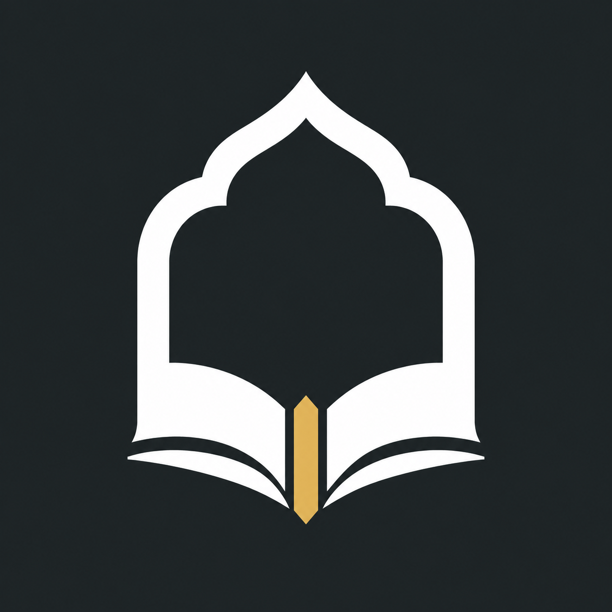

### Prompt

Use case: logo-brand. Create ONE polished flat 2D mobile app icon concept for a Quran and Islamic companion app. Square 1:1, straight-on vector-style graphic, bold simple silhouettes, excellent readability at 48 pixels. A solid completely uniform full-bleed background reaches all four edges. Center the emblem with generous 17 percent padding on every side. Use only the exact three solid colors specified for this concept. Pure unshaded fills, crisp smooth edges and deliberate negative space. Absolutely no gradients, shadows, lighting, metallic reflections, embossing, bevels, 3D, perspective, texture, grain, mockup, outer rounded-square border, lettering, Arabic text, captions, watermark, extra decorative objects, or ornamental clutter. Respectful treatment of the Quran. Output only this one finished icon, not a sheet of variations. Concept: one clever integrated emblem combining a pointed Islamic mihrab arch with an open Quran. Bold white arch sides continue smoothly into two broad white page shapes at its base; a small matte-gold central spine anchors the composition. The emblem reads first as a sacred arch and then as an open book, using generous dark negative space within the arch. No lantern, crescent, star or stand. Colors: charcoal #1D2426 background, white #FFFFFF emblem, matte gold #DEB35B spine. Elegant contemporary architectural geometry, symmetrical and distinctive.

## 3. Crescent Pages

### Prompt

Use case: logo-brand. Create ONE polished flat 2D mobile app icon concept for a Quran and Islamic companion app. Square 1:1, straight-on vector-style graphic, bold simple silhouettes, excellent readability at 48 pixels. A solid completely uniform full-bleed background reaches all four edges. Center the emblem with generous 17 percent padding on every side. Use only the exact three solid colors specified for this concept. Pure unshaded fills, crisp smooth edges and deliberate negative space. Absolutely no gradients, shadows, lighting, metallic reflections, embossing, bevels, 3D, perspective, texture, grain, mockup, outer rounded-square border, lettering, Arabic text, captions, watermark, extra decorative objects, or ornamental clutter. Respectful treatment of the Quran. Output only this one finished icon, not a sheet of variations. Concept: a large simple white open Quran with broad page silhouettes and a smaller gold crescent hovering directly above it. Make the crescent a smooth clean geometric shape with no face, decorative stars or tiny details. Keep a clear gap between crescent and book, with the book occupying more visual area than the crescent. No arch, lantern, stand or patterned frame. Colors: vivid cobalt #2454C6 background, white #FFFFFF Quran pages, matte warm gold #F1BD4C crescent. Fresh, welcoming and instantly legible.

## 4. Geometric Seal

### Prompt

Use case: logo-brand. Create ONE polished flat 2D mobile app icon concept for a Quran and Islamic companion app. Square 1:1, straight-on vector-style graphic, bold simple silhouettes, excellent readability at 48 pixels. A solid completely uniform full-bleed background reaches all four edges. Center the emblem with generous 17 percent padding on every side. Use only the exact three solid colors specified for this concept. Pure unshaded fills, crisp smooth edges and deliberate negative space. Absolutely no gradients, shadows, lighting, metallic reflections, embossing, bevels, 3D, perspective, texture, grain, mockup, outer rounded-square border, lettering, Arabic text, captions, watermark, extra decorative objects, or ornamental clutter. Respectful treatment of the Quran. Output only this one finished icon, not a sheet of variations. Concept: a single emerald eight-point Islamic geometric star with broad blunt points, centered on a white background. Cut a large unmistakable open Quran silhouette out of the center in white negative space, formed from two mirrored page shapes. A small gold bookmark sits at the central fold. The star is one solid simple shape, not interlaced linework or a complex ornamental rosette. No rings, arch, crescent, lantern, typography or tiny decorative patterns. Colors: pure white #FFFFFF background and book cutout, emerald #16715B star, matte gold #DDB04D bookmark. Clean, memorable, symmetrical geometric mark.

## 5. The Bookmark

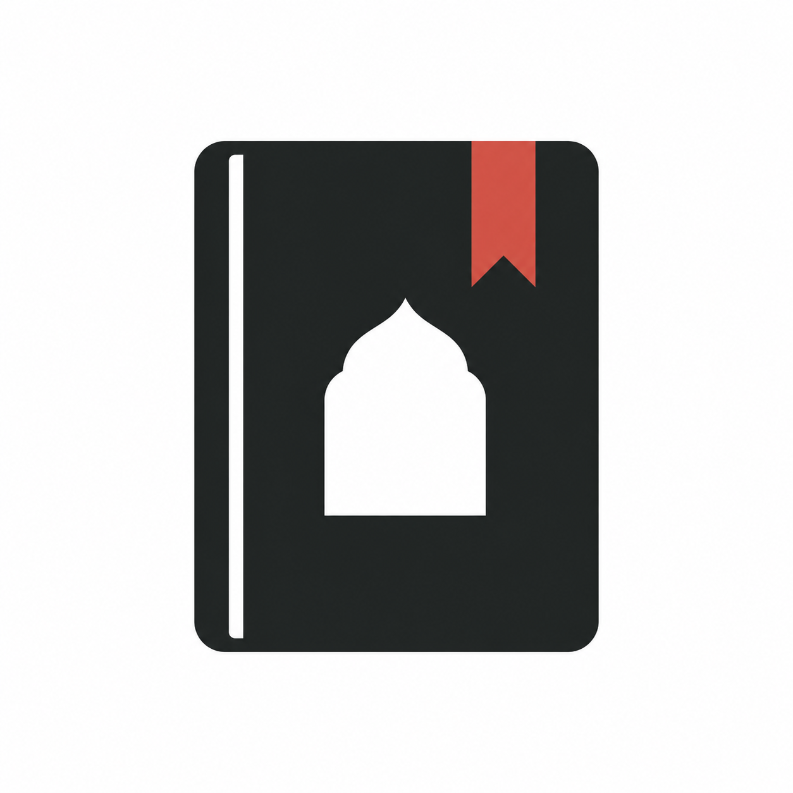

### Prompt

Use case: logo-brand. Create ONE polished flat 2D mobile app icon concept for a Quran and Islamic companion app. Square 1:1, straight-on vector-style graphic, bold simple silhouettes, excellent readability at 48 pixels. A solid completely uniform full-bleed background reaches all four edges. Center the emblem with generous 17 percent padding on every side. Use only the exact three solid colors specified for this concept. Pure unshaded fills, crisp smooth edges and deliberate negative space. Absolutely no gradients, shadows, lighting, metallic reflections, embossing, bevels, 3D, perspective, texture, grain, mockup, outer rounded-square border, lettering, Arabic text, captions, watermark, extra decorative objects, or ornamental clutter. Respectful treatment of the Quran. Output only this one finished icon, not a sheet of variations. Concept: a bold closed Quran cover seen completely straight-on, centered on a white background. The cover is a simple charcoal vertical book silhouette with gently rounded corners, a single thin white spine indication on the left, and one small white pointed Islamic arch emblem cut into its center. A muted-red ribbon bookmark extends from the top edge and has a clean V-shaped tip over the upper cover. No page stack, book thickness, perspective, shadows, gold, crescent, lantern, lettering or decoration. Colors: pure white #FFFFFF background and arch cutout, charcoal #202323 cover, muted vermilion #CF5146 bookmark. Very flat, graphic, modern editorial identity; the book cover is prominent and recognizable.

## Direction 2: Symbols And Arabic Lettering

Created: 2026-10-12. Five additional flat 2D previews generated with the built-in image tool. These explore Kaaba, Qaf, direction, dhikr, and prayer imagery. All remain pending user selection.

### 6. Kaaba

Prompt:

Use case: logo-brand. Asset type: a new flat 2D app icon concept for a Quran and Islamic companion app. Create one high-resolution 1:1 square icon with a completely uniform solid background extending to all four edges. Use crisp vector-like edges, bold simple flat shapes, generous negative space, and only the three specified solid colors. Keep the main emblem centered within about 66 percent of the canvas, readable at small launcher sizes. Clean contemporary visual identity, respectful Islamic subject matter. Completely flat fills: no gradient, grain, texture, shading, shadow, glow, bevel, metallic effect, extrusion, perspective, 3D, outer rounded-square container, mockup, watermarks or captions. No open Quran, closed book, book pages, mihrab arch, lantern, decorative star, ornamental border, or additional symbols. Output a single standalone app icon, not a collage. Subject: a bold, minimalist, strictly front-facing Kaaba silhouette. A simple almost-square charcoal facade, one flat gold horizontal kiswa band near its upper third, and one small gold rectangular door towards the lower-right part of the facade. The composition is geometric and unmistakably architectural, with no visible side or roof plane, no surrounding buildings, writing, pilgrims or ornament. Colors: pure white #FFFFFF background, charcoal #202323 Kaaba, matte gold #D6A340 band and door. The band must stop at the edges of the black silhouette. Quiet, strong, instantly memorable.

### 7. Qaf

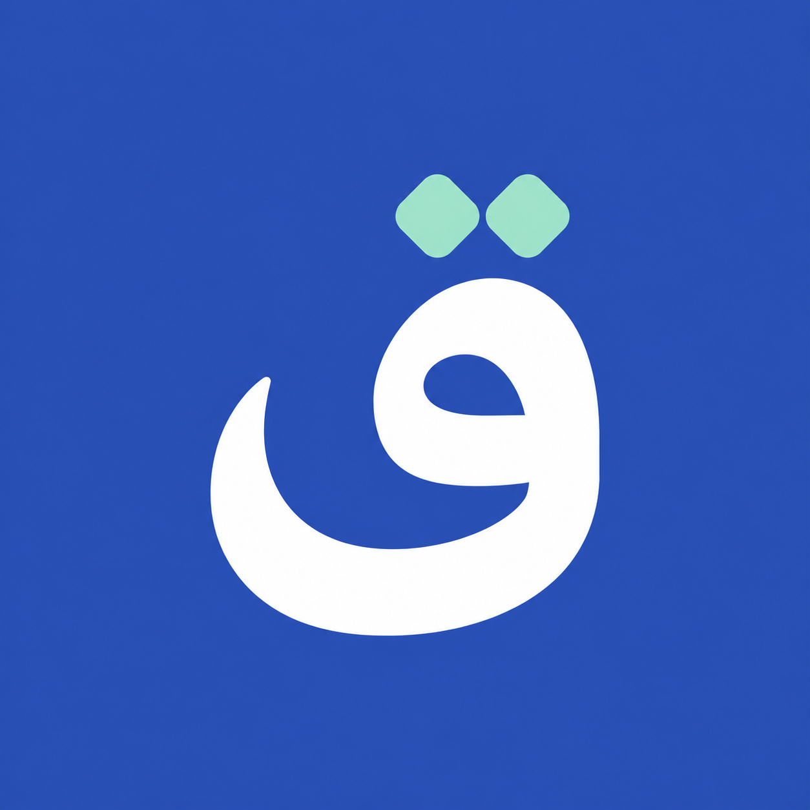

Prompt:

Use case: logo-brand. Asset type: a new flat 2D app icon concept for a Quran and Islamic companion app. Create one high-resolution 1:1 square icon with a completely uniform solid background extending to all four edges. Use crisp vector-like edges, bold simple flat shapes, generous negative space, and only the three specified solid colors. Keep the main emblem centered within about 66 percent of the canvas, readable at small launcher sizes. Clean contemporary visual identity, respectful Islamic subject matter. Completely flat fills: no gradient, grain, texture, shading, shadow, glow, bevel, metallic effect, extrusion, perspective, 3D, outer rounded-square container, mockup, watermarks or captions. No open Quran, closed book, book pages, mihrab arch, lantern, decorative star, ornamental border, or additional symbols. Output a single standalone app icon, not a collage. Subject: a typographic emblem made from exactly one correct Arabic letter Qaf, text verbatim: "ق". Use a bold modern Arabic display shape with a clearly recognizable rounded head and sweeping bowl, and exactly TWO rounded mint dots above the letter, aligned next to each other. The main letter is white; only its two required dots are mint. Correct Arabic character anatomy, not a Latin Q, not a crescent, not an invented glyph. No additional letters or text. Colors: solid cobalt #2B50B5 background, white #FFFFFF letter, mint #9CE1C8 two dots. A distinctive contemporary identity based on the initial Arabic letter of Quran.

### 8. Qibla Pointer

Prompt:

Use case: logo-brand. Asset type: a new flat 2D app icon concept for a Quran and Islamic companion app. Create one high-resolution 1:1 square icon with a completely uniform solid background extending to all four edges. Use crisp vector-like edges, bold simple flat shapes, generous negative space, and only the three specified solid colors. Keep the main emblem centered within about 66 percent of the canvas, readable at small launcher sizes. Clean contemporary visual identity, respectful Islamic subject matter. Completely flat fills: no gradient, grain, texture, shading, shadow, glow, bevel, metallic effect, extrusion, perspective, 3D, outer rounded-square container, mockup, watermarks or captions. No open Quran, closed book, book pages, mihrab arch, lantern, decorative star, ornamental border, or additional symbols. Output a single standalone app icon, not a collage. Subject: a single bold white direction-pointer emblem enclosed by a simple white circular compass outline. The pointer is a geometric diamond needle oriented about 30 degrees right of vertical. Its upper pointed half is white and its lower pointed half is charcoal, with a clearly defined central junction. The circular outline has only one intentional break at the upper-right point to suggest direction and movement. No cardinal letters, tick marks, map, location pin, book, crescent or extra icon. Colors: warm coral #D95D50 background, white #FFFFFF circle and forward needle, charcoal #262A2A reverse needle. Confident, practical, modern.

### 9. Dhikr Loop

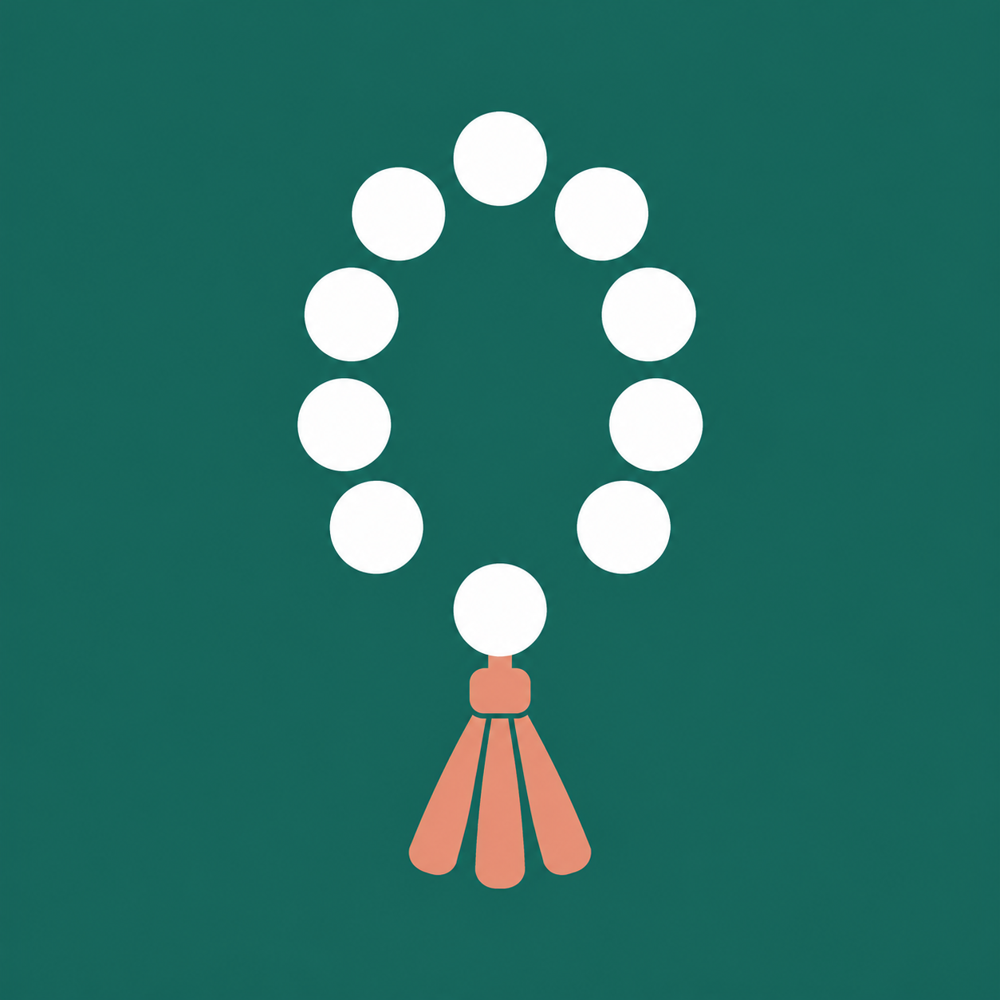

Prompt:

Use case: logo-brand. Asset type: a new flat 2D app icon concept for a Quran and Islamic companion app. Create one high-resolution 1:1 square icon with a completely uniform solid background extending to all four edges. Use crisp vector-like edges, bold simple flat shapes, generous negative space, and only the three specified solid colors. Keep the main emblem centered within about 66 percent of the canvas, readable at small launcher sizes. Clean contemporary visual identity, respectful Islamic subject matter. Completely flat fills: no gradient, grain, texture, shading, shadow, glow, bevel, metallic effect, extrusion, perspective, 3D, outer rounded-square container, mockup, watermarks or captions. No open Quran, closed book, book pages, mihrab arch, lantern, decorative star, ornamental border, or additional symbols. Output a single standalone app icon, not a collage. Subject: a stylized tasbih prayer-bead loop forming a clean vertical oval, with 11 large separate circular white beads and a short simple coral tassel hanging from its bottom center. The tassel has one connector and three broad flat strands, no thin hairs. White beads are equally sized and evenly spaced; allow enough negative space inside and between them. This is a graphic emblem, not a realistic product photo. No hands, extra beads, crescent, text, arch or book. Colors: solid deep green #17665B background, white #FFFFFF beads, muted coral #E8977D tassel. Gentle, tactile and contemporary.

### 10. Sujood

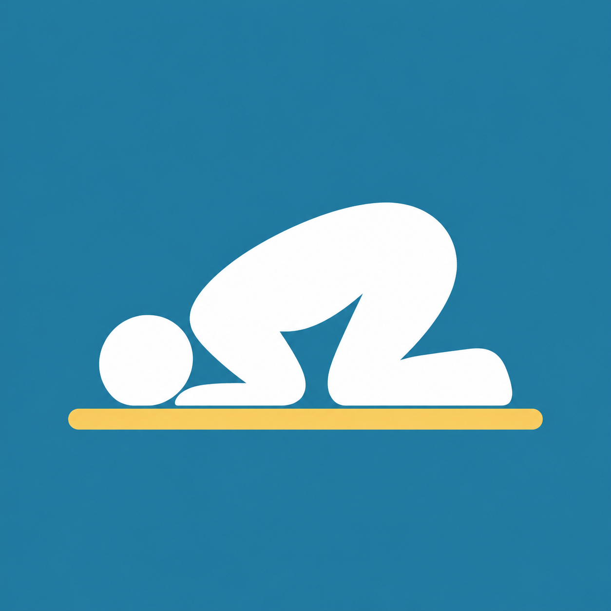

Prompt:

Use case: logo-brand. Asset type: a new flat 2D app icon concept for a Quran and Islamic companion app. Create one high-resolution 1:1 square icon with a completely uniform solid background extending to all four edges. Use crisp vector-like edges, bold simple flat shapes, generous negative space, and only the three specified solid colors. Keep the main emblem centered within about 66 percent of the canvas, readable at small launcher sizes. Clean contemporary visual identity, respectful Islamic subject matter. Completely flat fills: no gradient, grain, texture, shading, shadow, glow, bevel, metallic effect, extrusion, perspective, 3D, outer rounded-square container, mockup, watermarks or captions. No open Quran, closed book, book pages, mihrab arch, lantern, decorative star, ornamental border, or additional symbols. Output a single standalone app icon, not a collage. Subject: a respectful, simple abstract side-view silhouette of a person in sujood, prostrating in prayer and facing left, on one short horizontal prayer-mat stroke. Build the person from only a few bold smooth white shapes: a small round featureless head lowered to touch the mat, a curved bowed back rising from the head towards the right, and clearly folded kneeling legs on the right. Keep the posture anatomically coherent and instantly understandable. No face, clothing detail, fingers, realistic body rendering, mosque, dome, arch, crescent, book or surrounding objects. The mat is a single warm-yellow flat horizontal bar under the figure. Colors: solid sky blue #247B9B background, white #FFFFFF figure, muted sun yellow #F4CA67 mat. Calm, humane, recognizable icon.

## Direction 3: Layered And Dimensional

Created: 2026-10-12. The user requested more detail and depth after finding the previous concepts too simple and flat. Five additional previews generated with the built-in image tool explore illustrated book covers, layered paper, ceramic lettering, Kaaba architecture, and a miniature mosque. All remain pending user finalization; no launcher artwork was applied.

### 11. Jewel Quran

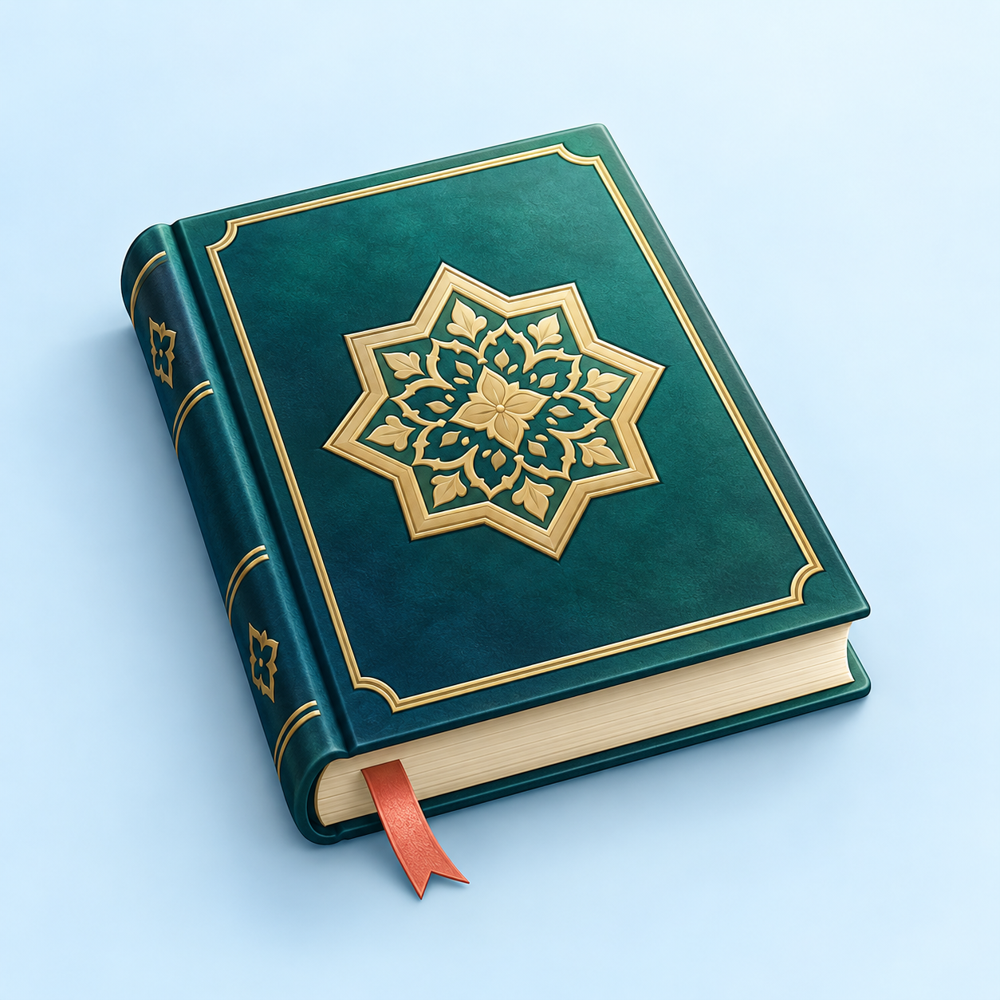

Prompt:

Use case: logo-brand. Create ONE polished premium mobile app icon concept for a Quran and Islamic companion app. The user rejected earlier plain flat silhouettes and now wants more character, visual richness and subtle depth. Use a sophisticated 2.5D illustrative approach with layered forms, controlled soft shading, tasteful material cues and selective small details. The main symbol must be large, recognizable and beautifully composed, not a busy scene. Square 1:1 composition, background fills all four edges, emblem centered with generous mask-safe margins. No surrounding app-icon frame, phone, grid, collage, captions, watermark, readable scripture, invented Arabic writing or random embellishments. Respectful subject matter. Avoid crude flat pictograms, excessive ornament, photorealism, gaudy chrome, overblown glowing effects and tiny fiddly details. Output only this one standalone icon. Subject: a beautifully designed closed Quran as the single dominant object, viewed at a gentle three-quarter angle with a small amount of illustrated thickness. A rich emerald-to-sapphire satin cover, restrained champagne-gold raised eight-point central medallion, a simple fine gold cover border, clean ivory page edges and one muted coral ribbon bookmark. No lettering on the cover, no stand, arch, lantern, crescent or extra object. Smooth carefully drawn shading gives the book volume without making it look like a photographed real product. Background: pale icy blue with an extremely subtle soft tonal change. Soft compact contact shadow below the book. The book should feel like a jewel-like editorial illustration with strong silhouette and uncluttered composition.

### 12. Paper Sanctuary

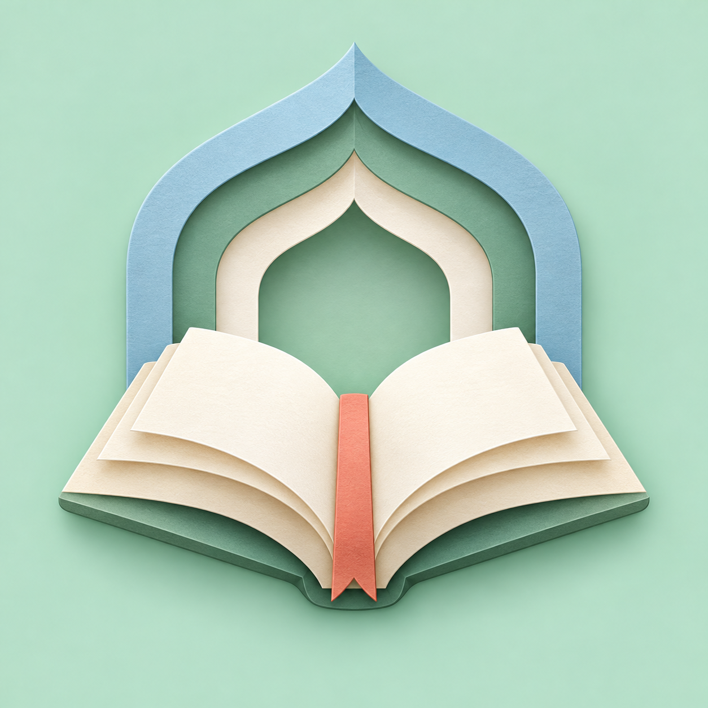

Prompt:

Use case: logo-brand. Create ONE polished premium mobile app icon concept for a Quran and Islamic companion app. The user rejected earlier plain flat silhouettes and now wants more character, visual richness and subtle depth. Use a sophisticated 2.5D illustrative approach with layered forms, controlled soft shading, tasteful material cues and selective small details. The main symbol must be large, recognizable and beautifully composed, not a busy scene. Square 1:1 composition, background fills all four edges, emblem centered with generous mask-safe margins. No surrounding app-icon frame, phone, grid, collage, captions, watermark, readable scripture, invented Arabic writing or random embellishments. Respectful subject matter. Avoid crude flat pictograms, excessive ornament, photorealism, gaudy chrome, overblown glowing effects and tiny fiddly details. Output only this one standalone icon. Subject: an expressive layered paper-cut illustration of a Quran reading niche. Three broad nested pointed arch layers made from folded paper in powder blue, muted sea green and warm white, with visible clean paper edges and gentle depth shadows. In front of the arch, a large open ivory Quran with a coral central bookmark, sculpted paper page curves and two subtle page-edge layers. No wooden stand, lantern, text, writing, stars or intricate patterns. The whole design is one compact emblem, not a rectangular architectural room or full illustration scene. Background: soft desaturated mint, full-bleed. Colorful but quiet and well balanced. Precisely crafted layered paper illustration, rich tactile depth, recognizable at icon scale.

### 13. Ceramic Qaf

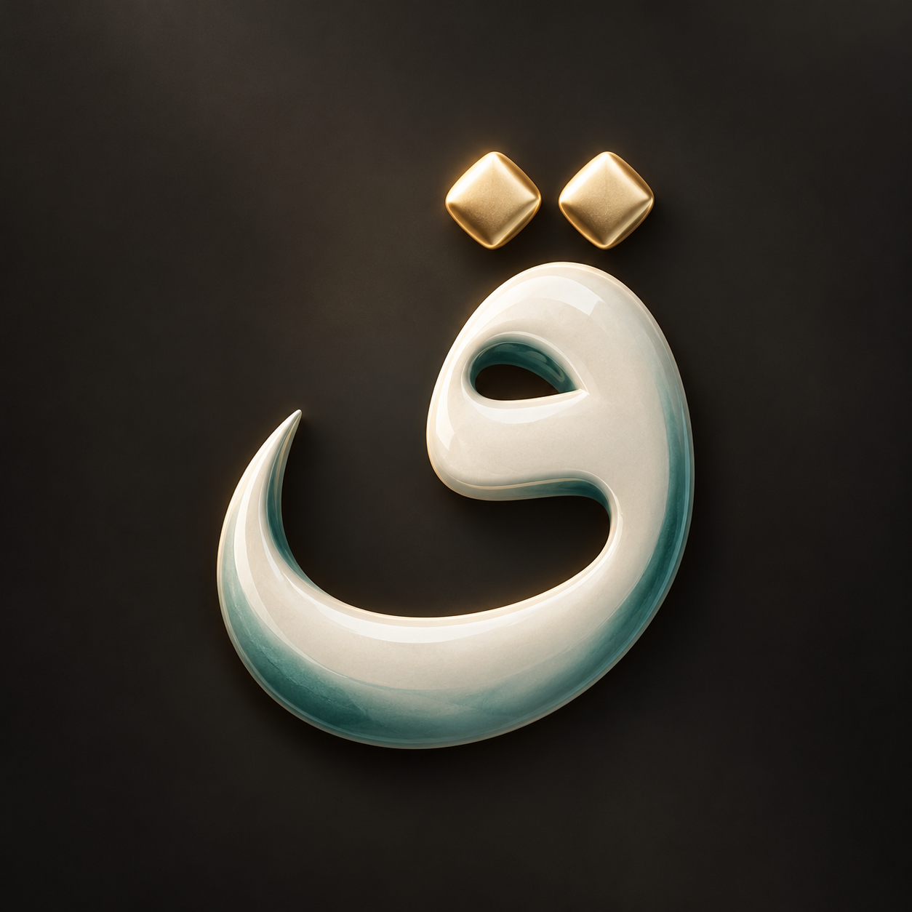

Prompt:

Use case: logo-brand. Create ONE polished premium mobile app icon concept for a Quran and Islamic companion app. The user rejected earlier plain flat silhouettes and now wants more character, visual richness and subtle depth. Use a sophisticated 2.5D illustrative approach with layered forms, controlled soft shading, tasteful material cues and selective small details. The main symbol must be large, recognizable and beautifully composed, not a busy scene. Square 1:1 composition, background fills all four edges, emblem centered with generous mask-safe margins. No surrounding app-icon frame, phone, grid, collage, captions, watermark, readable scripture, invented Arabic writing or random embellishments. Respectful subject matter. Avoid crude flat pictograms, excessive ornament, photorealism, gaudy chrome, overblown glowing effects and tiny fiddly details. Output only this one standalone icon. Subject: exactly one correctly formed Arabic letter Qaf, text verbatim "ق", made into a bold sculptural glazed-ceramic calligraphic emblem. Its rounded head and generous sweeping bowl must retain correct Arabic anatomy. Main letter: pearl white with subtle cool-teal glazing along its curved sides, rounded bevels and gentle dimensional shading. Exactly TWO small champagne-gold rounded diamond dots above its head, aligned next to each other. No additional letters, flourish, arch, book, crescent or surrounding ornament. Background: deep warm charcoal, full-bleed, with very subtle soft tonal depth. High-contrast refined calligraphy, lovely curved material surfaces, contemporary luxury rather than a flat logo or heavy realistic metal sculpture. Clear legibility and restrained depth.

### 14. Kaaba Courtyard

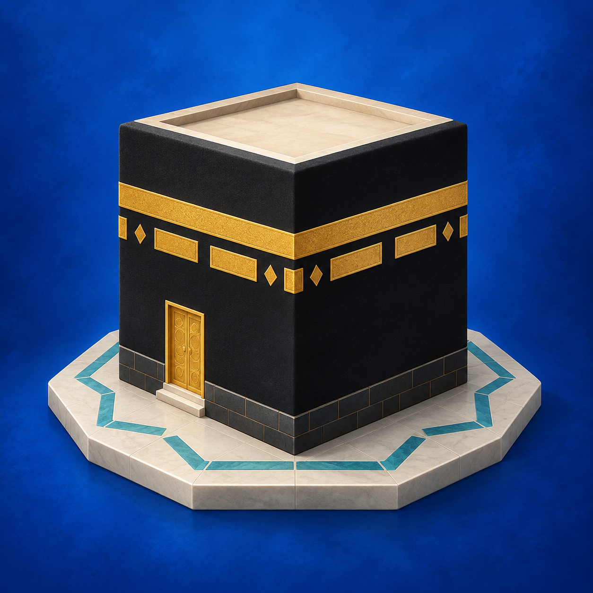

Prompt:

Use case: logo-brand. Create ONE polished premium mobile app icon concept for a Quran and Islamic companion app. The user rejected earlier plain flat silhouettes and now wants more character, visual richness and subtle depth. Use a sophisticated 2.5D illustrative approach with layered forms, controlled soft shading, tasteful material cues and selective small details. The main symbol must be large, recognizable and beautifully composed, not a busy scene. Square 1:1 composition, background fills all four edges, emblem centered with generous mask-safe margins. No surrounding app-icon frame, phone, grid, collage, captions, watermark, readable scripture, invented Arabic writing or random embellishments. Respectful subject matter. Avoid crude flat pictograms, excessive ornament, photorealism, gaudy chrome, overblown glowing effects and tiny fiddly details. Output only this one standalone icon. Subject: a stylized dimensional Kaaba as the dominant object, viewed from a gentle elevated three-quarter angle, with a visible top and two faces. Matte black and charcoal forms, one restrained matte-gold kiswa band and a small gold door, absolutely no calligraphy or scripture on the band. The Kaaba rests on a small pale stone courtyard base, drawn as a subtle eight-sided shallow plinth with a few broad turquoise geometric inlay lines, not an elaborate ornate border. No pilgrims, cityscape, mountains, books, arches, lanterns or realistic photo textures. Background: saturated but refined lapis blue with subtle soft atmospheric tonal depth. Clean shaded illustration with precise silhouette, soft contact shadow, ceremonial presence and contemporary app-icon finish.

### 15. Ceramic Mosque

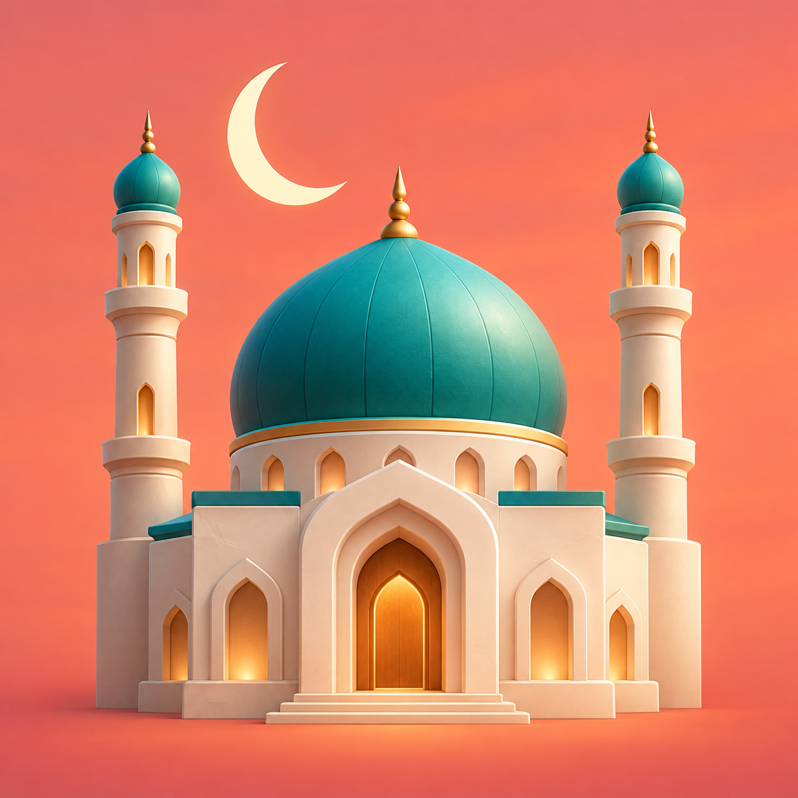

Prompt:

Use case: logo-brand. Create ONE polished premium mobile app icon concept for a Quran and Islamic companion app. The user rejected earlier plain flat silhouettes and now wants more character, visual richness and subtle depth. Use a sophisticated 2.5D illustrative approach with layered forms, controlled soft shading, tasteful material cues and selective small details. The main symbol must be large, recognizable and beautifully composed, not a busy scene. Square 1:1 composition, background fills all four edges, emblem centered with generous mask-safe margins. No surrounding app-icon frame, phone, grid, collage, captions, watermark, readable scripture, invented Arabic writing or random embellishments. Respectful subject matter. Avoid crude flat pictograms, excessive ornament, photorealism, gaudy chrome, overblown glowing effects and tiny fiddly details. Output only this one standalone icon. Subject: one charming but dignified miniature mosque rendered as a carefully shaded 2.5D ceramic illustration. A large turquoise domed roof, smooth warm-white walls, two slim but sturdy minarets with turquoise caps, and a simple central entrance with warm amber depth. Gentle rounded sculpted surfaces, crisp silhouette and a few broad architectural details; no tiny window grid, ornament, lettering or realistic texture. A small clean warm-white crescent sits behind the dome near the upper-left area, with generous separation from the minaret. Background: muted coral dusk with a soft subtle tonal change, full-bleed. No landscape, clouds, stars, people, book, freestanding arch frame or lantern. Modern, calm and welcoming, richer than a flat pictogram, not childish or overdecorated.

## Direction 4: Rich Flat Illustration

Created: 2026-10-12. The user clarified that the third direction was too 3D and still wants a flat icon. These five new previews add botanical detail, woven geometry, readable Kufic-inspired lettering, architectural illustration, and sun motifs through planar color and shape rather than dimensional materials. Generated with the built-in image tool. All remain pending user finalization; no launcher artwork was applied.

### 16. Botanical Pages

Prompt:

Use case: logo-brand. Create ONE finished square app icon concept for a Quran and Islamic companion app. The user wants a richer, thoughtfully illustrated FLAT 2D icon, not a bare pictogram and absolutely not a 3D render. Draw everything as a single planar vector illustration with sharp clean edges, opaque solid color fills, deliberate negative space, and expressive geometric or organic detail. Use the specified four or five colors, with no variations created by lighting. All shapes have ZERO physical thickness. Strictly no gradients, shadows, highlights, reflections, bevels, extrusion, embossing, perspective, isometric view, paper texture, grain, material texture, realistic lighting, clay, ceramic or photorealism. Keep a bold, readable main symbol and useful detail without tiny clutter. Frontal graphic composition, emblem fills approximately the central 70 percent of the square; full-bleed solid background. No phone, mockup, surrounding rounded-square tile, watermark, captions, random letters or scripture. Output one standalone icon only. Subject: an expressive open Quran in the center, with two broad cream-white symmetrical pages and a slender saffron bookmark, drawn completely flat and frontal. Three short dark-green horizontal marks on each page are abstract page-design marks, not Arabic letters or scripture. Two elegantly curved olive branches grow around the left and right of the book, each with four broad well-shaped leaves and one small coral olive. Branch stems are bold and leaves are simple flat silhouettes. The page curves and olive branches create one cohesive lively emblem, with carefully balanced rhythm and negative space. No arch, lantern, moon, star or stand. Palette: solid deep evergreen #174C43 background, warm white #FFFDF5 book, mint #98C9AA leaves, saffron #EAB64C bookmark, muted coral #E57D66 olives. Contemporary Mediterranean editorial illustration with rich but controlled detail, strictly flat vector art.

### 17. Woven Pages

Prompt:

Use case: logo-brand. Create ONE finished square app icon concept for a Quran and Islamic companion app. The user wants a richer, thoughtfully illustrated FLAT 2D icon, not a bare pictogram and absolutely not a 3D render. Draw everything as a single planar vector illustration with sharp clean edges, opaque solid color fills, deliberate negative space, and expressive geometric or organic detail. Use the specified four or five colors, with no variations created by lighting. All shapes have ZERO physical thickness. Strictly no gradients, shadows, highlights, reflections, bevels, extrusion, embossing, perspective, isometric view, paper texture, grain, material texture, realistic lighting, clay, ceramic or photorealism. Keep a bold, readable main symbol and useful detail without tiny clutter. Frontal graphic composition, emblem fills approximately the central 70 percent of the square; full-bleed solid background. No phone, mockup, surrounding rounded-square tile, watermark, captions, random letters or scripture. Output one standalone icon only. Subject: a richly designed flat geometric Quran emblem. A large central cream-white open Quran is surrounded by an interwoven arrangement of four broad cobalt ribbons and four broad turquoise ribbons, creating a compact eight-point Islamic geometric rosette. The ribbons intersect with crisp cream-white separation gaps, not shadows or physical overlap depth. Each page has two simple cobalt horizontal decorative strokes and a small central coral bookmark. Use a limited number of broad shapes so the design has the richness of tilework without a tiny repeating pattern. All elements lie in one 2D plane, no thick object edges. Palette: warm white #FFFDF8 background and pages, cobalt #2957B5 ribbons, turquoise #298B87 ribbons, muted coral #D96853 bookmark. Sophisticated Islamic tile-inspired graphic identity, detailed yet coherent, no rings, lantern, crescent, wood or gold.

### 18. Kufic Quran

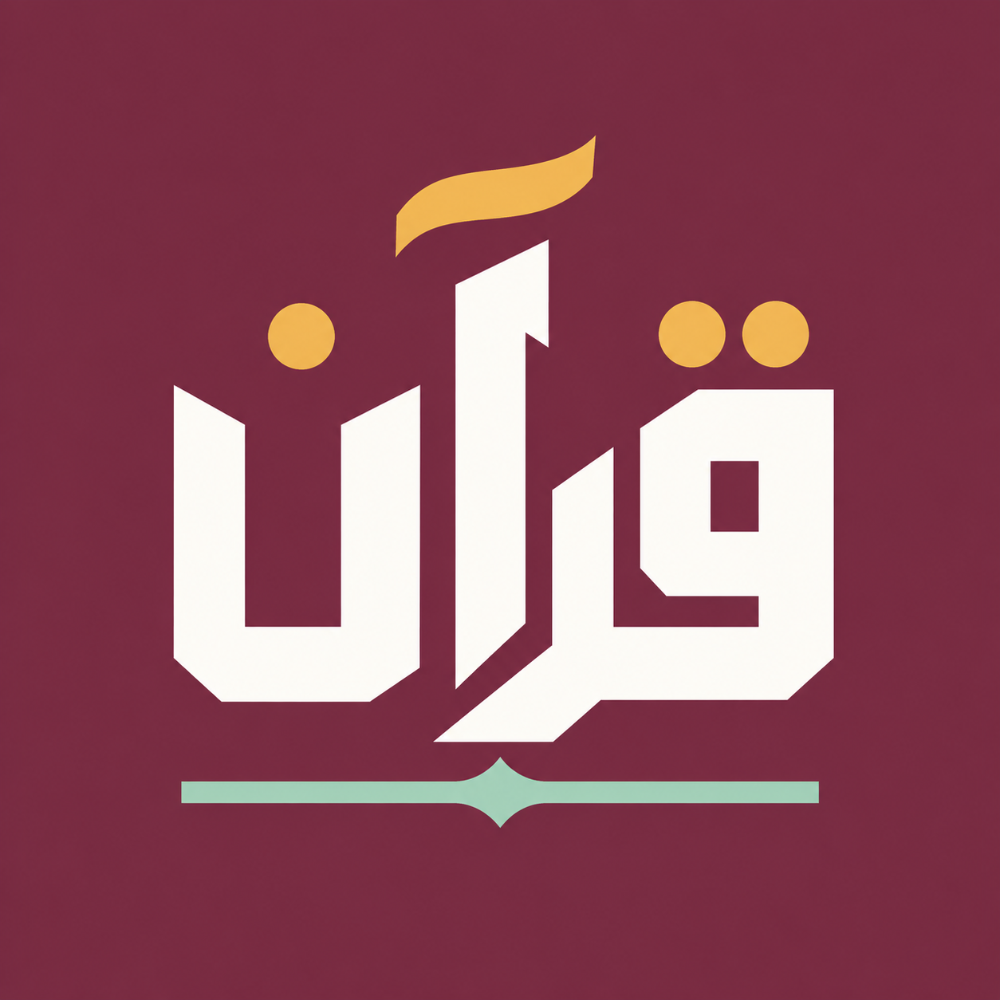

Prompt:

Use case: logo-brand. Create ONE finished square app icon concept for a Quran and Islamic companion app. The user wants a richer, thoughtfully illustrated FLAT 2D icon, not a bare pictogram and absolutely not a 3D render. Draw everything as a single planar vector illustration with sharp clean edges, opaque solid color fills, deliberate negative space, and expressive geometric or organic detail. Use the specified four or five colors, with no variations created by lighting. All shapes have ZERO physical thickness. Strictly no gradients, shadows, highlights, reflections, bevels, extrusion, embossing, perspective, isometric view, paper texture, grain, material texture, realistic lighting, clay, ceramic or photorealism. Keep a bold, readable main symbol and useful detail without tiny clutter. Frontal graphic composition, emblem fills approximately the central 70 percent of the square; full-bleed solid background. No phone, mockup, surrounding rounded-square tile, watermark, captions, random letters or scripture. Output one standalone icon only. Subject: exactly the Arabic word "قرآن" as the dominant emblem, accurately written and readable, drawn in bold contemporary geometric Kufic-inspired Arabic lettering. Preserve the correct letter anatomy: Qaf has two dots, Alif has its maddah above, and Noon has its one dot. Make the word a compact visually balanced near-square arrangement while maintaining correct right-to-left reading order and legibility. Use broad warm-white strokes, saffron dots and maddah, and one small mint horizontal ornamental rule underneath the word. Letterforms may have intentional sharp corners and clean geometric counters, but must not turn into an unreadable maze. No other text, Latin letters, book, arch, lantern, crescent or extra symbol. Palette: solid oxblood #762D42 background, warm white #FFFDF7 lettering, saffron #EDB450 dots and maddah, mint #9FC5B0 rule. A distinctive detailed typographic app identity, completely flat ink-like vector graphics.

### 19. Illustrated Courtyard

Prompt:

Use case: logo-brand. Create ONE finished square app icon concept for a Quran and Islamic companion app. The user wants a richer, thoughtfully illustrated FLAT 2D icon, not a bare pictogram and absolutely not a 3D render. Draw everything as a single planar vector illustration with sharp clean edges, opaque solid color fills, deliberate negative space, and expressive geometric or organic detail. Use the specified four or five colors, with no variations created by lighting. All shapes have ZERO physical thickness. Strictly no gradients, shadows, highlights, reflections, bevels, extrusion, embossing, perspective, isometric view, paper texture, grain, material texture, realistic lighting, clay, ceramic or photorealism. Keep a bold, readable main symbol and useful detail without tiny clutter. Frontal graphic composition, emblem fills approximately the central 70 percent of the square; full-bleed solid background. No phone, mockup, surrounding rounded-square tile, watermark, captions, random letters or scripture. Output one standalone icon only. Subject: a compact ornate-but-clean FRONT ELEVATION illustration of a mosque, a large teal central dome, two white minarets, three broad white facade panels and a central indigo pointed doorway. Two small saffron window rectangles and a few thick indigo contour lines add architectural detail. A small saffron crescent sits above the dome. Two low stylized teal garden-leaf shapes anchor the bottom corners of the facade. Build the entire design from clean flat geometric and curved color blocks in one plane. Absolutely no side planes, cylindrical shading, cast shadows, steps with depth, ceramic surfaces or glowing windows. Palette: solid dusty coral #D77E76 background, warm white #FFF9EC walls, teal #287C75 dome and leaves, deep indigo #343553 outlines and door, saffron #F0C16B windows and crescent. Contemporary illustrated travel-poster graphic style, charming architectural character and clear Islamic identity, no book or surrounding arch frame.

### 20. Radiant Pages

Prompt:

Use case: logo-brand. Create ONE finished square app icon concept for a Quran and Islamic companion app. The user wants a richer, thoughtfully illustrated FLAT 2D icon, not a bare pictogram and absolutely not a 3D render. Draw everything as a single planar vector illustration with sharp clean edges, opaque solid color fills, deliberate negative space, and expressive geometric or organic detail. Use the specified four or five colors, with no variations created by lighting. All shapes have ZERO physical thickness. Strictly no gradients, shadows, highlights, reflections, bevels, extrusion, embossing, perspective, isometric view, paper texture, grain, material texture, realistic lighting, clay, ceramic or photorealism. Keep a bold, readable main symbol and useful detail without tiny clutter. Frontal graphic composition, emblem fills approximately the central 70 percent of the square; full-bleed solid background. No phone, mockup, surrounding rounded-square tile, watermark, captions, random letters or scripture. Output one standalone icon only. Subject: a striking, expressive flat open-Quran emblem with a rising sun incorporated into its center fold. The book has broad warm-white pages, deep-charcoal bold contours, and two short teal decorative page strokes on each side. A saffron semicircle rises from the upper central fold, surrounded by seven broad short saffron sun rays arranged in a tidy fan, all solid graphic shapes. A coral bookmark drops from the book's center. The book is drawn directly front-on with symmetrical curved page edges, absolutely no book thickness, perspective, page stacks, shading or shadows. Palette: solid pale mint #C7E1D7 background, warm white #FFFDF8 pages, deep charcoal #273D3A contours and page marks, saffron #E5AA37 sun, muted coral #D26D57 bookmark. Bold editorial illustration with a memorable detailed silhouette and optimistic character. No crescent, arch, lantern, frame or realistic glow.

## Direction 5: New Symbols And Compositions

Created: 2026-10-12. The user requested five completely new concepts. This set explores a prayer rug, calligraphy pen, lunar calendar, constructivist minaret, and abstract unity knot, retaining the requested flat illustrative style. Generated with the built-in image tool. These are design previews only; user finalization is still required before integration.

### 21. Prayer Rug

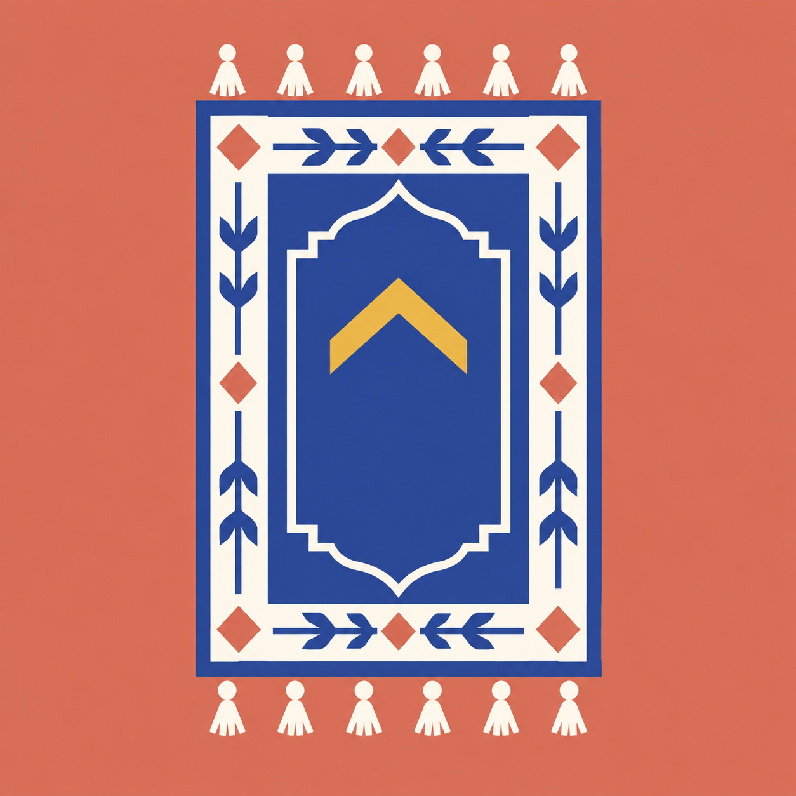

Prompt:

Use case: logo-brand. Create ONE new square app icon concept for a Quran and Islamic companion app. This is a fresh exploration, not a variation of earlier open-book, olive-branch, woven-star, Qaf-letter, mosque-facade, Kaaba, crescent-over-book, or lantern-in-arch designs. The user wants a developed FLAT 2D graphic illustration with character and intentional detail, rather than a bare pictogram. Use clean planar vector-style shapes, crisp edges, solid opaque color fills, confident contours and generous negative space. Absolutely NO 3D, perspective, isometric view, bevel, embossing, physical thickness, shadows, gradients, realistic lighting, reflection, paper texture, grain or photographic materials. Square 1:1, full-bleed solid background, main emblem centered with useful margin for launcher masks. No outer rounded-square frame, phone mockup, captions, watermark, scripture or invented Arabic writing. Output one standalone icon, not a collage. Subject: a richly designed prayer rug viewed perfectly straight-on from directly above, its upright rectangular silhouette as the main emblem. The rug is deep cobalt with a broad warm-white border interrupted by four simple coral diamond motifs. At the center is one geometric saffron directional chevron made from two thick strokes, pointing towards the top of the rug, not an architectural arch. Two short rows of three warm-white tassel shapes finish the top and bottom. Keep the rug and ornament perfectly flat, without folds, fabric texture or thickness. No book, mosque, crescent, star, beads, people or letters. Palette: solid warm coral #D66D5B background, cobalt #2F4A9B rug, warm white #FFF9EE border and tassels, saffron #EAB849 directional chevron. Modern textile-inspired graphic identity, enough large ornamental detail to feel distinctive.

### 22. Reed Pen

Prompt:

Use case: logo-brand. Create ONE new square app icon concept for a Quran and Islamic companion app. This is a fresh exploration, not a variation of earlier open-book, olive-branch, woven-star, Qaf-letter, mosque-facade, Kaaba, crescent-over-book, or lantern-in-arch designs. The user wants a developed FLAT 2D graphic illustration with character and intentional detail, rather than a bare pictogram. Use clean planar vector-style shapes, crisp edges, solid opaque color fills, confident contours and generous negative space. Absolutely NO 3D, perspective, isometric view, bevel, embossing, physical thickness, shadows, gradients, realistic lighting, reflection, paper texture, grain or photographic materials. Square 1:1, full-bleed solid background, main emblem centered with useful margin for launcher masks. No outer rounded-square frame, phone mockup, captions, watermark, scripture or invented Arabic writing. Output one standalone icon, not a collage. Subject: a bold diagonal qalam reed pen and three expressive calligraphic ink strokes, celebrating Quranic study and writing. The pen is an elongated saffron flat silhouette angled from lower-left to upper-right, with a crisp split nib and two short warm-white grip bands. Below and to the left of the nib, three broad charcoal curved ink strokes form a flowing fan with clear spacing; these are abstract decorative strokes, not letters, words or scripture. Add one small coral circular ink dot as a deliberate finishing accent. Keep everything in the same flat graphic plane, no cast shadow or realistic wooden material. No book, scroll, arch, mosque, crescent, star or lantern. Palette: solid warm white #FFF9ED background, charcoal #2A3431 ink, saffron #DBA33D pen, muted coral #CC6D58 accent. Sophisticated editorial illustration with strong asymmetry and visual movement.

### 23. Sacred Time

Prompt:

Use case: logo-brand. Create ONE new square app icon concept for a Quran and Islamic companion app. This is a fresh exploration, not a variation of earlier open-book, olive-branch, woven-star, Qaf-letter, mosque-facade, Kaaba, crescent-over-book, or lantern-in-arch designs. The user wants a developed FLAT 2D graphic illustration with character and intentional detail, rather than a bare pictogram. Use clean planar vector-style shapes, crisp edges, solid opaque color fills, confident contours and generous negative space. Absolutely NO 3D, perspective, isometric view, bevel, embossing, physical thickness, shadows, gradients, realistic lighting, reflection, paper texture, grain or photographic materials. Square 1:1, full-bleed solid background, main emblem centered with useful margin for launcher masks. No outer rounded-square frame, phone mockup, captions, watermark, scripture or invented Arabic writing. Output one standalone icon, not a collage. Subject: an expressive Islamic-calendar emblem, completely front-facing and flat. The main object is a warm-white calendar leaf with a boldly curved bottom edge, two charcoal binding tabs at the top, and a broad teal header stripe. The center contains one large coral circle with a saffron crescent cutout motif inside it, while three short charcoal date strokes sit beneath. No actual numerals or text. The calendar silhouette has two small decorative saffron corner squares for visual richness, not a surrounding border. No 3D page fold, curled paper edge, page-stack thickness or shadow. No book, mosque, arch, Kaaba, lantern or beads. Palette: solid deep teal #205C57 background, warm white #FFFBF2 calendar, charcoal #293B38 binding and strokes, coral #D77567 lunar badge, saffron #E9BC5A crescent. Friendly, purposeful contemporary flat illustration.

### 24. Geometric Minaret

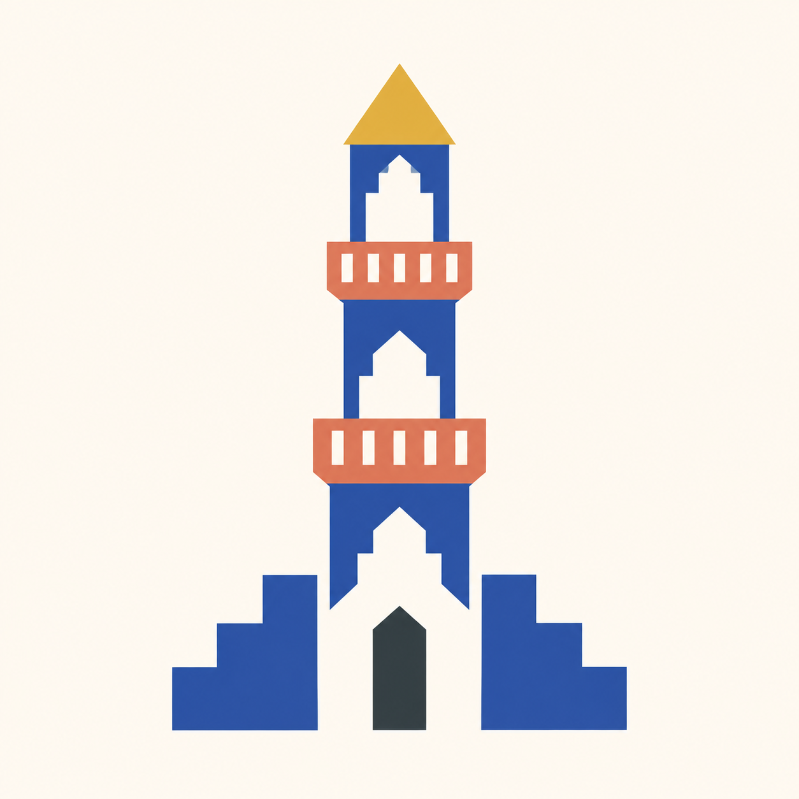

Prompt:

Use case: logo-brand. Create ONE new square app icon concept for a Quran and Islamic companion app. This is a fresh exploration, not a variation of earlier open-book, olive-branch, woven-star, Qaf-letter, mosque-facade, Kaaba, crescent-over-book, or lantern-in-arch designs. The user wants a developed FLAT 2D graphic illustration with character and intentional detail, rather than a bare pictogram. Use clean planar vector-style shapes, crisp edges, solid opaque color fills, confident contours and generous negative space. Absolutely NO 3D, perspective, isometric view, bevel, embossing, physical thickness, shadows, gradients, realistic lighting, reflection, paper texture, grain or photographic materials. Square 1:1, full-bleed solid background, main emblem centered with useful margin for launcher masks. No outer rounded-square frame, phone mockup, captions, watermark, scripture or invented Arabic writing. Output one standalone icon, not a collage. Subject: one completely new bold abstract minaret emblem inspired by patterned architectural tiles, not a literal mosque illustration. Create a tall central tower from five broad alternating cobalt and warm-white geometric blocks, with two distinct coral balcony bands and a small saffron pointed cap. The lower block has a charcoal single narrow doorway. Two stepped cobalt side shapes anchor its base like a symmetrical skyline. Use clever interlocking proportions and a few large geometric cuts for distinctive rhythm, all solid flat color. No domed mosque, arch frame, book, crescent, star, lantern, garden, tiny windows or decorative writing. Palette: solid pale warm white #FFF9EF background, cobalt #3155A6 tower and base shapes, coral #D67862 balcony bands, saffron #E4AF43 cap, charcoal #293533 doorway. Architectural constructivist poster style, structured and memorable, absolutely no cylindrical shading or side planes.

### 25. Unity Knot

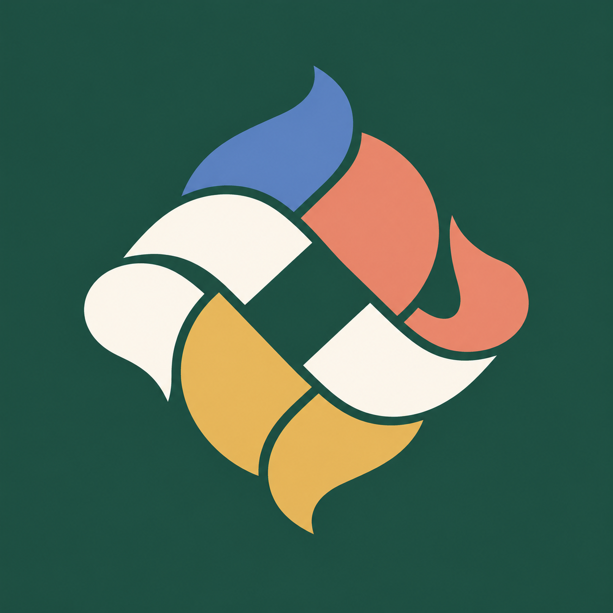

Prompt:

Use case: logo-brand. Create ONE new square app icon concept for a Quran and Islamic companion app. This is a fresh exploration, not a variation of earlier open-book, olive-branch, woven-star, Qaf-letter, mosque-facade, Kaaba, crescent-over-book, or lantern-in-arch designs. The user wants a developed FLAT 2D graphic illustration with character and intentional detail, rather than a bare pictogram. Use clean planar vector-style shapes, crisp edges, solid opaque color fills, confident contours and generous negative space. Absolutely NO 3D, perspective, isometric view, bevel, embossing, physical thickness, shadows, gradients, realistic lighting, reflection, paper texture, grain or photographic materials. Square 1:1, full-bleed solid background, main emblem centered with useful margin for launcher masks. No outer rounded-square frame, phone mockup, captions, watermark, scripture or invented Arabic writing. Output one standalone icon, not a collage. Subject: a distinctive abstract four-ribbon unity knot inspired by Islamic interlacing, but absolutely not a star, rosette, flower, crescent, arch or open book. Four broad curved ribbons in cobalt, coral, saffron and warm white connect around a small diamond-shaped empty center, forming a compact asymmetric continuous loop emblem with four rounded outside lobes. At crossings, separate the bands with crisp background-colored cutout gaps, never shadows or layered physical depth. Give each ribbon one bold tapered terminal so the mark feels like rhythmic calligraphic movement without forming letters. No repeating tiny patterns or enclosing circle. Palette: solid deep pine #204E43 background, cobalt #5979BA ribbon, coral #DF856E ribbon, saffron #E7B858 ribbon, warm white #FFF9EE ribbon. Rich graphic identity with color, movement and symbolic togetherness, elegant flat vector illustration.

## Direction 6: Quran As The Primary Subject

Created: 2026-10-12. The user rejected direction five as unrelated to a Quran app. Updated design criterion: the Quran itself must be the dominant, immediately recognizable subject; general Islamic feature symbols are insufficient as the primary app identity. These five flat illustrated previews explore a recognizable Mushaf cover, illuminated pages, Quran-labelled bookmark, ayah medallion, and highlighted study spread. Generated with the built-in image tool. User finalization is still required before any integration.

### 26. Mushaf Cover

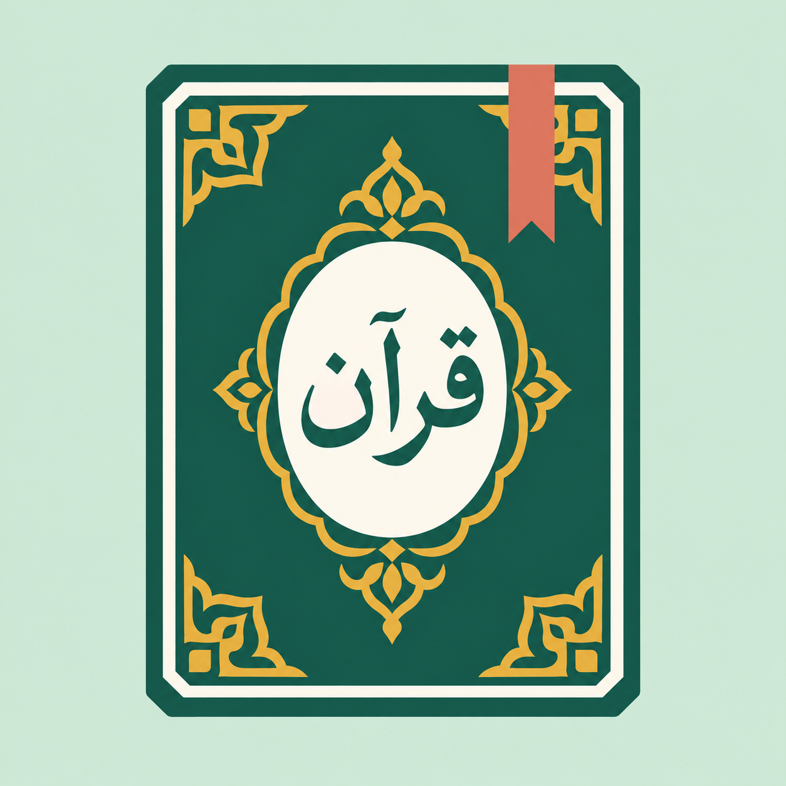

Prompt:

Use case: logo-brand. Create ONE new app-icon concept for an app whose main purpose is reading and studying the QURAN. The user rejected generic prayer rugs, pens, calendars, minarets and abstract knots because they did not communicate a Quran app. The QURAN must now be the unmistakable dominant central subject, occupying at least two thirds of the emblem. The user wants a rich, attractive FLAT 2D illustration, with considered linework, color and relevant detail, not a bare pictogram and absolutely not 3D. Use crisp vector-like edges, solid opaque colors, direct frontal or direct top-down graphic views and broad purposeful shapes. Strictly no perspective, isometric view, shading, gradients, physical thickness, bevels, shadows, reflections, lighting, paper texture, grain, photographed material or 3D surfaces. Square 1:1, full-bleed solid background, leave generous safe margins around the emblem. No rounded-square outer frame, phone mockup, watermark, labels, invented Arabic or scripture. No mosque, minaret, prayer rug, calendar, standalone pen, generic abstract knot, Kaaba, olive branches, surrounding mihrab arch, lantern or generic crescent as the main subject. Output one standalone icon only. Subject: a distinctive CLOSED QURAN COVER, shown directly front-on as a completely flat vertical rectangle with softly chamfered corners. The rich emerald cover has a thick warm-white outer border and four large saffron corner ornaments, each made from a few angular strokes. At its center is a broad warm-white oval medallion with exactly the Arabic word "قرآن" correctly written in emerald, clear and legible, no other lettering. A coral ribbon bookmark descends from the top edge along the upper-right part of the cover. No book thickness, page stack, spine side plane or shadow. Background: solid pale mint #D5E9DA. Palette: emerald #18574B, warm white #FFFAEF, saffron #DDA43A, coral #D7775D, pale mint background. Strong Quran-specific visual identity, detailed cover-design illustration, restrained ornament and clear silhouette.

### 27. Illuminated Pages

Prompt:

Use case: logo-brand. Create ONE new app-icon concept for an app whose main purpose is reading and studying the QURAN. The user rejected generic prayer rugs, pens, calendars, minarets and abstract knots because they did not communicate a Quran app. The QURAN must now be the unmistakable dominant central subject, occupying at least two thirds of the emblem. The user wants a rich, attractive FLAT 2D illustration, with considered linework, color and relevant detail, not a bare pictogram and absolutely not 3D. Use crisp vector-like edges, solid opaque colors, direct frontal or direct top-down graphic views and broad purposeful shapes. Strictly no perspective, isometric view, shading, gradients, physical thickness, bevels, shadows, reflections, lighting, paper texture, grain, photographed material or 3D surfaces. Square 1:1, full-bleed solid background, leave generous safe margins around the emblem. No rounded-square outer frame, phone mockup, watermark, labels, invented Arabic or scripture. No mosque, minaret, prayer rug, calendar, standalone pen, generic abstract knot, Kaaba, olive branches, surrounding mihrab arch, lantern or generic crescent as the main subject. Output one standalone icon only. Subject: a LARGE OPEN QURAN shown front-on in a graphic symmetrical layout, with two warm-white pages, thick deep-indigo outlines and a coral central bookmark. Each page has a broad decorative turquoise rectangular inner border with small saffron stepped corners, evoking a traditional illuminated Mushaf page. Inside each page, three bold short deep-indigo lines and one small saffron rosette are purely abstract page-layout marks, not letters or scripture. Keep the decoration on the pages themselves, with no surrounding star or arch. The open Quran is the only object. Background: solid turquoise #328B86. Palette: warm white #FFF9ED pages, deep indigo #29334C outlines and page marks, saffron #E4B247 ornaments, coral #D86D59 bookmark, turquoise background. Lively rich flat editorial illustration; no realistic curled pages or book thickness.

### 28. Quran Reading Mark

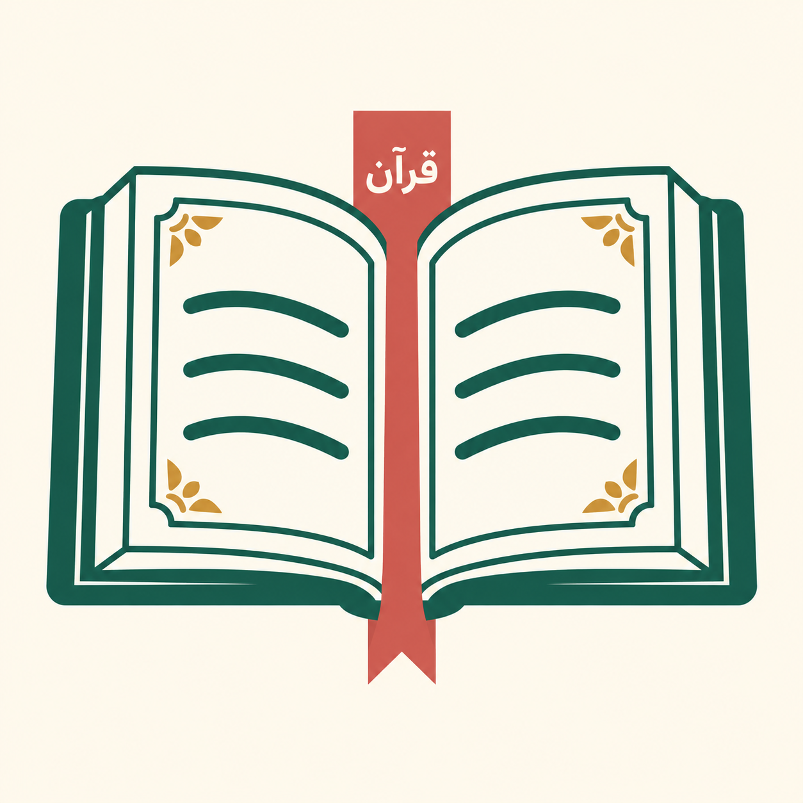

Prompt:

Use case: logo-brand. Create ONE new app-icon concept for an app whose main purpose is reading and studying the QURAN. The user rejected generic prayer rugs, pens, calendars, minarets and abstract knots because they did not communicate a Quran app. The QURAN must now be the unmistakable dominant central subject, occupying at least two thirds of the emblem. The user wants a rich, attractive FLAT 2D illustration, with considered linework, color and relevant detail, not a bare pictogram and absolutely not 3D. Use crisp vector-like edges, solid opaque colors, direct frontal or direct top-down graphic views and broad purposeful shapes. Strictly no perspective, isometric view, shading, gradients, physical thickness, bevels, shadows, reflections, lighting, paper texture, grain, photographed material or 3D surfaces. Square 1:1, full-bleed solid background, leave generous safe margins around the emblem. No rounded-square outer frame, phone mockup, watermark, labels, invented Arabic or scripture. No mosque, minaret, prayer rug, calendar, standalone pen, generic abstract knot, Kaaba, olive branches, surrounding mihrab arch, lantern or generic crescent as the main subject. Output one standalone icon only. Subject: a LARGE OPEN QURAN with a distinctive coral bookmark continuing from its central fold into a broad upright ribbon above the pages. On the upright part of that ribbon, exactly the Arabic word "قرآن" is written correctly in warm white in small but clear bold lettering, identifying the book explicitly. The two pages are warm white with strong emerald contours, three bold emerald abstract line marks on each page and a pair of small saffron corner motifs. The ribbon has a clean V-cut tail below the book and is flat, not folded or dimensional. Background: solid warm white #FFF9EC. Palette: emerald #24564A outlines, warm white pages and background, coral #C85C53 ribbon, saffron #DCAA49 corners. One coherent Quran-and-bookmark composition with character and relevant detail. No arch, stars, crescent, pen, screen outline or extra objects.

### 29. Ayah Medallion

Prompt:

Use case: logo-brand. Create ONE new app-icon concept for an app whose main purpose is reading and studying the QURAN. The user rejected generic prayer rugs, pens, calendars, minarets and abstract knots because they did not communicate a Quran app. The QURAN must now be the unmistakable dominant central subject, occupying at least two thirds of the emblem. The user wants a rich, attractive FLAT 2D illustration, with considered linework, color and relevant detail, not a bare pictogram and absolutely not 3D. Use crisp vector-like edges, solid opaque colors, direct frontal or direct top-down graphic views and broad purposeful shapes. Strictly no perspective, isometric view, shading, gradients, physical thickness, bevels, shadows, reflections, lighting, paper texture, grain, photographed material or 3D surfaces. Square 1:1, full-bleed solid background, leave generous safe margins around the emblem. No rounded-square outer frame, phone mockup, watermark, labels, invented Arabic or scripture. No mosque, minaret, prayer rug, calendar, standalone pen, generic abstract knot, Kaaba, olive branches, surrounding mihrab arch, lantern or generic crescent as the main subject. Output one standalone icon only. Subject: a LARGE OPEN QURAN resting visually inside a simple bold circular turquoise field, drawn entirely flat and frontal. The circular field is part of the emblem, not an outer app-icon frame, and the page tips extend slightly beyond its sides. The book has warm-white pages, deep-cobalt contours, three short abstract cobalt page strokes on each side and a saffron central bookmark. At the book's lower central fold, place a small coral ornamental ayah-end medallion with scalloped edges and a warm-white center, containing no numerals or text. The ayah medallion is a relevant small secondary detail, while the open Quran remains clearly dominant. Background: solid pale sky #DFE9F2. Palette: pale sky background, turquoise #2A8682 field, warm white #FFF9ED pages, cobalt #2E4D90 contours, saffron #E2AD42 bookmark, coral #D5725F ayah medallion. Refined flat illustrated Quran-reading identity, no surrounding rosette, arch, moon, mosque or unrelated symbol.

### 30. Mushaf Study

Prompt:

Use case: logo-brand. Create ONE new app-icon concept for an app whose main purpose is reading and studying the QURAN. The user rejected generic prayer rugs, pens, calendars, minarets and abstract knots because they did not communicate a Quran app. The QURAN must now be the unmistakable dominant central subject, occupying at least two thirds of the emblem. The user wants a rich, attractive FLAT 2D illustration, with considered linework, color and relevant detail, not a bare pictogram and absolutely not 3D. Use crisp vector-like edges, solid opaque colors, direct frontal or direct top-down graphic views and broad purposeful shapes. Strictly no perspective, isometric view, shading, gradients, physical thickness, bevels, shadows, reflections, lighting, paper texture, grain, photographed material or 3D surfaces. Square 1:1, full-bleed solid background, leave generous safe margins around the emblem. No rounded-square outer frame, phone mockup, watermark, labels, invented Arabic or scripture. No mosque, minaret, prayer rug, calendar, standalone pen, generic abstract knot, Kaaba, olive branches, surrounding mihrab arch, lantern or generic crescent as the main subject. Output one standalone icon only. Subject: a direct top-down FLAT GRAPHIC VIEW of one large open Quran spread, almost square in its overall silhouette, with two deep-emerald-bordered warm-white pages separated by a thick coral central bookmark. The left page contains three bold emerald abstract text-layout strokes and one saffron underlining mark. The right page contains three corresponding emerald strokes, with the middle stroke enclosed by a simple saffron rectangular study highlight. Add a few broad geometric emerald corner details inside each page, like a designed Mushaf margin, never a surrounding ornamental frame. Abstract strokes only, no scripture, fake letters or extra text. The visual should communicate reading and reflecting on the Quran, with all information on the book itself. Background: solid warm coral #D47A65. Palette: coral background and bookmark, emerald #225C4D contours and marks, warm white #FFF9E9 pages, saffron #E9B94F highlight. Engaging, clearly Quran-centered, flat illustrated study identity, no pen, magnifying glass, screen, arch or additional objects.

## Direction 7: Illustrated Character And Gentle Shading

Created: 2026-10-12. After finding direction six too flat, the user requested a fresh direction. These previews keep the Quran as the primary subject and explore drawn editorial illustration with restrained painted/cel shading rather than plain pictograms or realistic 3D objects. Concepts: illustrated cover, Quran recitation, Quran on rehal, night reading, and heart-like page contours. Generated with the built-in image tool. User finalization is still required before integration.

### 31. Ink And Gold

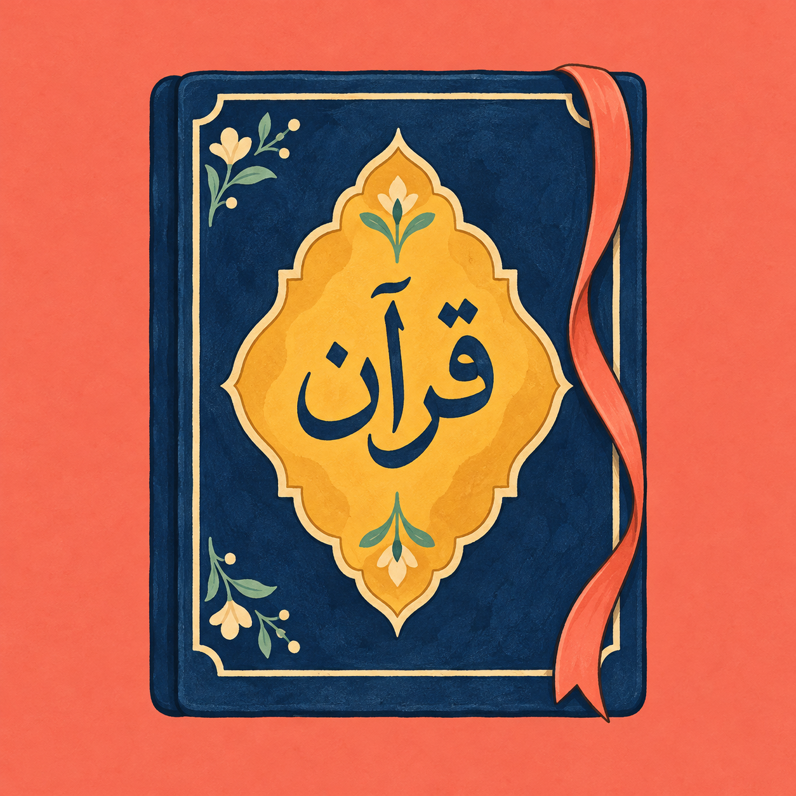

Prompt:

Use case: logo-brand. Create ONE fresh app-icon concept for an app primarily used to read and listen to the Quran. The Quran must be the unmistakable dominant central subject. Find the middle ground between overly plain flat pictograms and realistic 3D icons: a beautifully drawn TWO-DIMENSIONAL editorial illustration with expressive contours, considered decorative detail, a few softly painted or cel-shaded color areas and strong small-size readability. It should look DRAWN, like a premium illustrated sticker or painted app emblem, not a photograph, rendered 3D object, clay miniature, ceramic sculpture or embossed metal product. Keep depth restrained and graphical, without shiny highlights, photorealistic texture, deep extrusion, heavy drop shadows or dramatic perspective. Square 1:1, background fills all edges, artwork centered with generous mask-safe margin. No outer rounded-square icon container, phone mockup, collage, captions, watermark, invented Arabic, or readable Quran verses. No mosque, minaret, Kaaba, calendar or prayer rug. Only one finished icon. Subject: a boldly hand-illustrated CLOSED MUSHAF seen directly front-on. Its deep ink-blue cover has slightly organic hand-drawn corners, a fine warm-ivory inset border, and a large saffron central cover panel with exactly the Arabic word "قرآن" correctly written in ink blue. The central panel is not metallic, simply a painted decorative shape with two very restrained mustard tonal areas. A long coral ribbon bookmark follows a lively S-curve down the outside of the right cover edge, ending near the lower corner. Two small ivory floral corner marks on the left balance the ribbon. No page-stack thickness, side-view spine or photorealism. Background: muted warm coral. Colors: ink blue, warm ivory, saffron, coral, small muted mint accent. Contemporary ink-and-gouache editorial illustration, charming confident outlines and shallow hand-painted tonal variation, not a simple vector rectangle.

### 32. Quran Recitation

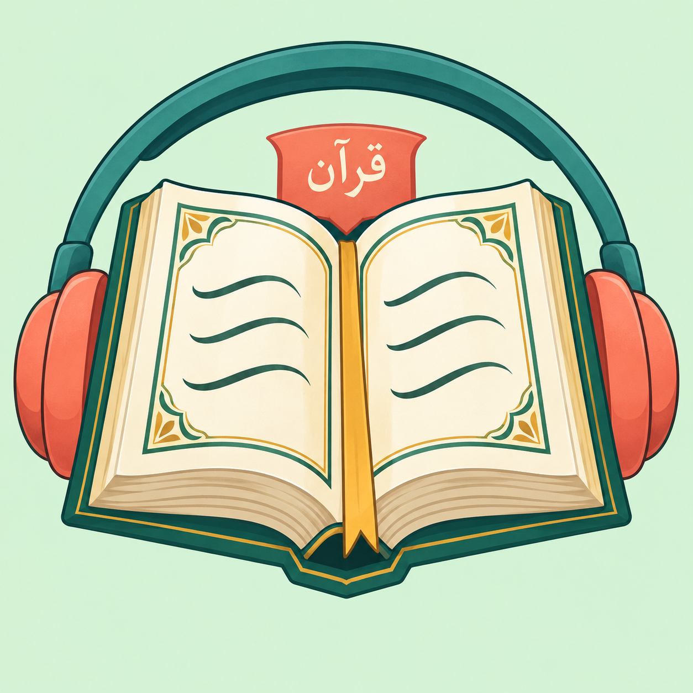

Prompt:

Use case: logo-brand. Create ONE fresh app-icon concept for an app primarily used to read and listen to the Quran. The Quran must be the unmistakable dominant central subject. Find the middle ground between overly plain flat pictograms and realistic 3D icons: a beautifully drawn TWO-DIMENSIONAL editorial illustration with expressive contours, considered decorative detail, a few softly painted or cel-shaded color areas and strong small-size readability. It should look DRAWN, like a premium illustrated sticker or painted app emblem, not a photograph, rendered 3D object, clay miniature, ceramic sculpture or embossed metal product. Keep depth restrained and graphical, without shiny highlights, photorealistic texture, deep extrusion, heavy drop shadows or dramatic perspective. Square 1:1, background fills all edges, artwork centered with generous mask-safe margin. No outer rounded-square icon container, phone mockup, collage, captions, watermark, invented Arabic, or readable Quran verses. No mosque, minaret, Kaaba, calendar or prayer rug. Only one finished icon. Subject: a LARGE OPEN QURAN, drawn as a warm, expressive 2D illustration, surrounded by a broad teal headphone band with two simple coral ear cups at the lower sides. The Quran occupies most of the center and is the first thing seen; the headphones are a relevant secondary recitation cue. The warm-ivory pages have dark ink-green contours, small saffron corner details, three broad abstract ink strokes on each page and a saffron central bookmark. Gentle cream-versus-ivory painted shading inside the page curves gives life without making a realistic 3D book. Exactly the small Arabic word "قرآن" is correctly written on a simple coral ribbon tab above the center fold. Background: soft pale mint. No surrounding architecture, moon, star, phone screen or music notes. Premium storybook editorial style, confident rounded contour lines, restrained cel shading, readable joyful Quran-audio identity.

### 33. Quran On Rehal

Prompt:

Use case: logo-brand. Create ONE fresh app-icon concept for an app primarily used to read and listen to the Quran. The Quran must be the unmistakable dominant central subject. Find the middle ground between overly plain flat pictograms and realistic 3D icons: a beautifully drawn TWO-DIMENSIONAL editorial illustration with expressive contours, considered decorative detail, a few softly painted or cel-shaded color areas and strong small-size readability. It should look DRAWN, like a premium illustrated sticker or painted app emblem, not a photograph, rendered 3D object, clay miniature, ceramic sculpture or embossed metal product. Keep depth restrained and graphical, without shiny highlights, photorealistic texture, deep extrusion, heavy drop shadows or dramatic perspective. Square 1:1, background fills all edges, artwork centered with generous mask-safe margin. No outer rounded-square icon container, phone mockup, collage, captions, watermark, invented Arabic, or readable Quran verses. No mosque, minaret, Kaaba, calendar or prayer rug. Only one finished icon. Subject: an illustrated OPEN QURAN resting on a small X-shaped rehal book stand, all rendered in a frontal stylized TWO-DIMENSIONAL drawing. The Quran is large, with beautifully curved ivory page shapes, broad emerald inset page borders, two simple saffron corner motifs and a coral bookmark dropping from the center. Page content is three abstract dark-green strokes per side, never fake scripture. The supporting rehal is compact beneath the book, made from two broad warm-ochre intersecting shapes with a few cream cutout dots; it must not have realistic wood texture or camera perspective. Use gentle two-tone color shading and organic ink contours like an illustrated children's-book cover for adults, dignified rather than childish. Background: pale warm blue. Add no lantern, mihrab arch, mosque, crescent or additional object. Richly illustrated Quran-reading emblem with just a touch of graphical depth, not a 3D product render.

### 34. Night Reader

Prompt:

Use case: logo-brand. Create ONE fresh app-icon concept for an app primarily used to read and listen to the Quran. The Quran must be the unmistakable dominant central subject. Find the middle ground between overly plain flat pictograms and realistic 3D icons: a beautifully drawn TWO-DIMENSIONAL editorial illustration with expressive contours, considered decorative detail, a few softly painted or cel-shaded color areas and strong small-size readability. It should look DRAWN, like a premium illustrated sticker or painted app emblem, not a photograph, rendered 3D object, clay miniature, ceramic sculpture or embossed metal product. Keep depth restrained and graphical, without shiny highlights, photorealistic texture, deep extrusion, heavy drop shadows or dramatic perspective. Square 1:1, background fills all edges, artwork centered with generous mask-safe margin. No outer rounded-square icon container, phone mockup, collage, captions, watermark, invented Arabic, or readable Quran verses. No mosque, minaret, Kaaba, calendar or prayer rug. Only one finished icon. Subject: a large open Quran illustrated in warm ivory and muted saffron against a solid deep ink-blue night background. Its page contours are lively hand-drawn dark teal curves, with broad ornamental page borders, three abstract ink strokes per page and a small coral ribbon. Two restrained cream-and-saffron tonal washes on the page faces suggest gentle warm reading light, but there is no volumetric glow or realistic lighting. Above the upper-right page, place one tiny cream crescent and two simple saffron four-point marks, tucked into the composition as quiet night-reading details, never competing with the book. No stand, lantern, architecture, surrounding border or sky scene. Elegant moody gouache-style TWO-DIMENSIONAL illustration, soft painted color transitions only inside the book, high readability and Quran-centered composition. Absolutely no photographic materials or rendered bevels.

### 35. Heart Of Quran

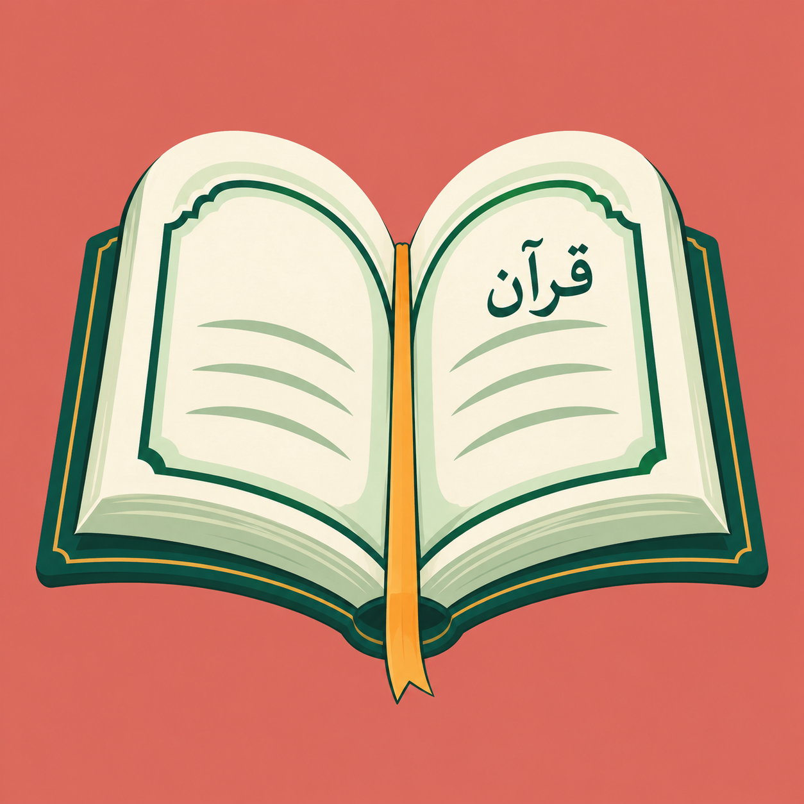

Prompt:

Use case: logo-brand. Create ONE fresh app-icon concept for an app primarily used to read and listen to the Quran. The Quran must be the unmistakable dominant central subject. Find the middle ground between overly plain flat pictograms and realistic 3D icons: a beautifully drawn TWO-DIMENSIONAL editorial illustration with expressive contours, considered decorative detail, a few softly painted or cel-shaded color areas and strong small-size readability. It should look DRAWN, like a premium illustrated sticker or painted app emblem, not a photograph, rendered 3D object, clay miniature, ceramic sculpture or embossed metal product. Keep depth restrained and graphical, without shiny highlights, photorealistic texture, deep extrusion, heavy drop shadows or dramatic perspective. Square 1:1, background fills all edges, artwork centered with generous mask-safe margin. No outer rounded-square icon container, phone mockup, collage, captions, watermark, invented Arabic, or readable Quran verses. No mosque, minaret, Kaaba, calendar or prayer rug. Only one finished icon. Subject: a distinctive open Quran whose broad curved upper page edges gently create a heart-like overall silhouette. It must still read unmistakably as an OPEN QURAN first, not a generic heart: clear center fold, two visible ivory pages, deep-green page border lines, three abstract page strokes per side, and a saffron central bookmark. Correctly write the small Arabic word "قرآن" in dark green near the top of one page, no other lettering or verses. The heart comes from the page contours themselves, not an added floating heart. Use a few warm-ivory and pale-mint cel-shaded sections to give the drawn page shapes personality without physical book thickness. Background: muted dusty coral, with a clean full-bleed field. Modern tender 2D poster illustration with deep teal ink contours, restrained hand-painted depth and a fresh readable silhouette. No olive branches, arch, lantern, rose petals, stand or extra symbol.

## Preferred Direction Refinement: Ink And Gold

Updated: 2026-10-12. The user liked the first concept in direction seven, `31-ink-and-gold.png`, and requested a version without the watercolor treatment and with a different background. The revised preview retains the cover, Arabic word, floral details, and curved coral bookmark, with a cleaner digital finish and pale mint background. Generated with the built-in image tool using concept 31 as the edit target. This is a preferred direction, not final approval to apply the launcher icon.

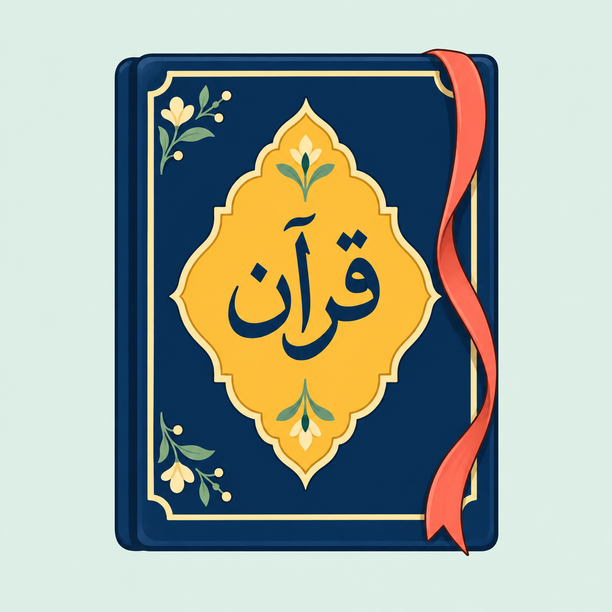

Prompt:

Use case: style-transfer. The supplied image is the edit target: the user's preferred Quran app icon, concept 31 Ink And Gold. Create ONE refined version. Preserve its composition and recognizable design: the upright ink-navy Quran cover, inset ivory/gold border, large saffron ornamental cover medallion, the exact correctly written Arabic word "قرآن" in navy, the small ivory flowers and muted-green leaves at the upper-left and lower-left, and the lively coral S-curved ribbon along the right side. Preserve the relative positions, proportions, book shape, generous padding and dignified visual identity. Change ONLY the finish and background color. Replace the watercolor/gouache treatment with a clean polished digital illustration: crisp smooth contours, consistent line weights, solid uniform color areas and restrained smooth two-tone cel shading where useful. REMOVE ALL brush texture, watercolor blooms, mottling, grain, paper texture, speckles, roughness and painted-material effects from every part, including the navy cover, gold panel and coral ribbon. Keep enough illustrative character and gentle graphical depth; do not reduce it to a plain flat pictogram, and do not make it photorealistic or a realistic 3D object. Change the existing coral background to a perfectly uniform soft pale mint #E1EEE7, full-bleed to all four edges, with no gradient, texture or drop shadow. The ribbon stays coral; the cover stays ink navy; the medallion stays saffron/gold and the lettering stays navy. Square finished icon, no mockup, outer rounded-square frame, captions, new text or additional objects. Output only the single clean finished icon.

### White Background Variation

Updated: 2026-10-12. Requested white-background version of the preferred clean digital concept. Source: `31-ink-and-gold-clean-mint.png`. Output: `31-ink-and-gold-clean-white.png`. Background changed to white while retaining the cover, lettering, floral details, and coral bookmark. Generated with the built-in image tool. Initially a preview; approved for launcher integration on 2026-10-13.

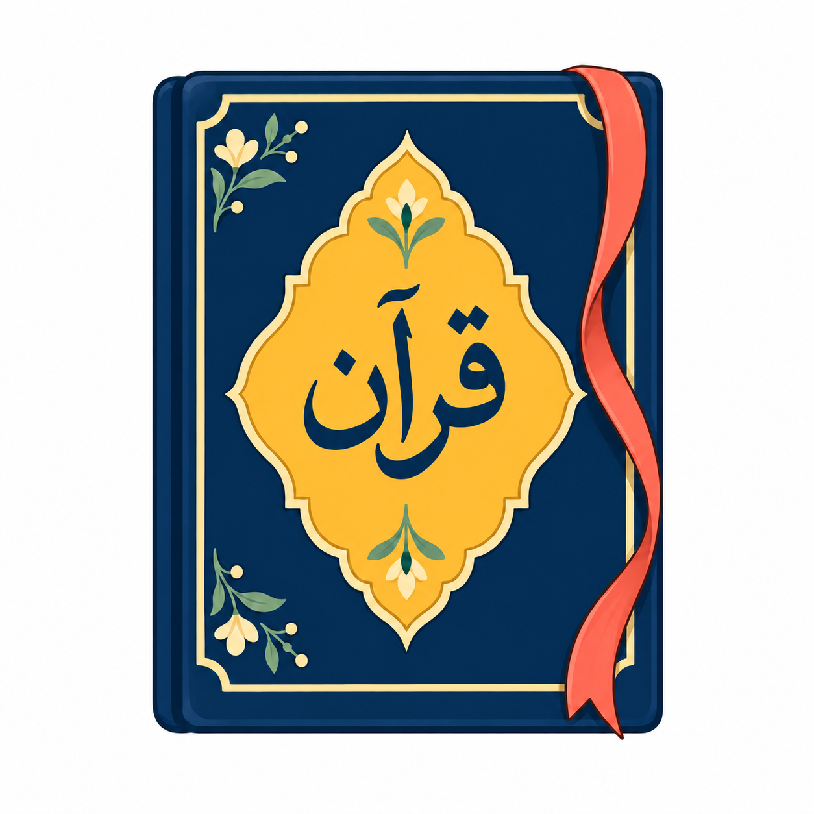

Prompt:

Use case: precise-object-edit. The supplied image is the edit target: the clean digital Quran app icon with a pale mint background. Change ONLY the background outside the book and ribbon to solid pure white #FFFFFF. The white must fill the square canvas uniformly, including all four corners. No off-white, mint tint, texture, vignette, gradient or cast shadow. Preserve the entire foreground design exactly: the upright navy Quran cover, gold/ivory inset border, gold ornamental medallion, exact correctly written Arabic word "قرآن", ivory flowers and muted-green leaves, the curved coral ribbon on the right, all proportions, position, padding, colors, smooth digital finish and restrained cel shading. Do not redraw, simplify, recolor, move or add anything to the foreground. Square opaque finished image; no mockup or outer frame. Output only this single white-background version.

## Approved Launcher And Round Adaptation

Updated: 2026-10-13. The user requested applying the white design as the app icon and adjusting it into a round version. This is explicit approval, superseding the earlier preview-only restriction.

- Square source: `31-ink-and-gold-clean-white.png`, copied unchanged to `assets/app_icon/logo.png`.
- Round source: the approved white square. Output: `31-ink-and-gold-clean-round.png`, copied to `assets/app_icon/logo_round.png`.
- Round composition: circular navy cover emblem, gold Quran medallion, ivory floral details, and a coral ribbon following the right rim; transparent exterior rather than a clipped rectangular cover.
- Original generated output retained at `/Users/farhanfida/.codex/generated_images/019dc502-c27e-7171-89dc-44c6220f90ed/exec-03b5a486-2746-4d1b-8476-ccc917adee92.png`.
- Applied to standard/round Android legacy and adaptive resources, plus every existing iOS AppIcon slot. Previous masters archived.
- All 27 PNG dimensions and transparency checks passed. Android resource compilation and iOS device-platform asset-catalog compilation passed. Small exports were inspected; adaptive foreground clearance was checked at the pixel level and corrected with a 20% inset.

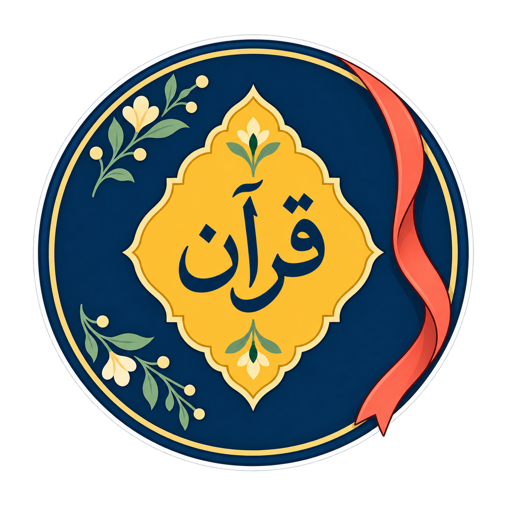

Round edit prompt:

Use case: precise-object-edit. Asset type: circular Android launcher icon, square PNG with TRUE TRANSPARENCY outside its circular boundary. The supplied white-background Quran icon is the edit target, already selected by the user. Create its matching circular version. Adapt the outer NAVY RECTANGULAR COVER into a perfectly round navy Quran-cover emblem, keeping the same clean digital illustrative style and restrained cel shading. Preserve the gold ornamental central medallion and the exact correctly written Arabic word "قرآن", the ivory flowers and muted-green leaves, the coral S-curved bookmark, and the navy/gold/ivory/coral palette. Replace the rectangular inset border with a thin concentric ivory-and-gold circular inset line. Reposition the floral details to follow the upper-left and lower-left of the circular rim. Curve the coral bookmark along the right circumference from approximately two o'clock to five o'clock, keeping its entire ribbon and V-cut tip INSIDE the circular boundary. Compact the central medallion only enough to comfortably fit the circle, with the lettering large and clear. The outer edge must be a mathematically clean, centered true circle with an even thin white outer rim, equal 2 percent transparent padding on all four sides, and NO white square corner background. All pixels outside that outer circular white rim must be genuinely transparent. No rectangular book edges, no square framing, no watercolor, grain, texture, extra lettering, new objects, 3D photorealism, cast shadow outside the circle, checkerboard pattern drawn into the image or mockup. Output only the single finished matching circular icon.

## Next Step

Review the next installed build on physical devices for launcher size, mask appearance, and cached icons. No app build, installation, or simulator run was performed for this icon update. Exact native files, export dimensions, and validation limits are listed in `assets/app_icon/README.md`.

